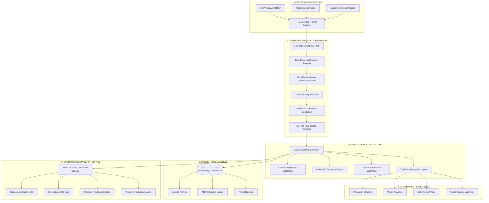

<div align="center">

<!-- Hero Banner -->


<!-- Dynamic Animated Typing Subtitle -->
<a href="https://github.com/envyakki/nayan">
  
</a>

<br/>

<!-- Technology Badges -->
<p align="center">
  <a href="https://fastapi.tiangolo.com" target="_blank">
    
  </a>
  <a href="https://react.dev" target="_blank">
    
  </a>
  <a href="https://typescriptlang.org" target="_blank">
    
  </a>
  <a href="https://leafletjs.com" target="_blank">
    
  </a>
  <a href="https://tailwindcss.com" target="_blank">
    
  </a>
  <a href="LICENSE">
    
  </a>
</p>

</div>

---

## 📌 Executive Summary

**NAYAN** (*Networked AI for Yield & ANPR Navigation*) is an enterprise-grade, high-density **Automated Number Plate Recognition (ANPR)**, vehicle movement tracking, and intelligent traffic management platform engineered for Smart Cities, Law Enforcement, and Advanced Traffic Management Systems (ATMS).

Designed to operate in complex, real-world Indian traffic environments, NAYAN marries real-time optical computer vision with spatial GIS corridor tracking, kinematic anomaly detection, and autonomous multi-source intelligence correlation across government transport portals (MoRTH Parivahan, Delhi Police) and regional public web records.

```
                      ┌───────────────────────────────────────────────┐
                      │              NAYAN ATMS PLATFORM               │
                      └───────────────────────┬───────────────────────┘
                                              │
        ┌─────────────────────────────────────┼─────────────────────────────────────┐
        ▼                                     ▼                                     ▼
 ┌──────────────┐                      ┌──────────────┐                      ┌──────────────┐
 │ OPTICAL ANPR │                      │  SPATIAL GIS │                      │ INTELLIGENCE │
 │  DETECTION   │                      │  TRAJECTORY  │                      │ CORRELATION  │
 ├──────────────┤                      ├──────────────┤                      ├──────────────┤
 │ • Reticle HUD│                      │ • Sensor Grid│                      │ • Parivahan  │
 │ • Indian OCR │                      │ • Kinematics │                      │ • E-Challan  │
 │ • Deduplicat.│                      │ • Speed Check│                      │ • Public Web │
 └──────────────┘                      └──────────────┘                      └──────────────┘
```

---

## 🚀 Key Architectural Capabilities

### 1. Optical Perception & Reticle HUD
- **Real-Time Video Ingestion**: Supports direct browser video streams (`navigator.mediaDevices.getUserMedia()`), network IP cameras, and RTSP CCTV endpoints.
- **Dynamic Viewfinder Reticle**: Military-grade tactical HUD viewfinder with corner brackets, target bounding boxes, optical stream indicators, and real-time FPS/latency telemetry.

### 2. Multi-Stage Indian License Plate OCR Pipeline
- **Image Preprocessing**: Consecutive bilateral filtering, morphological gradient analysis, adaptive thresholding, and Otsu binarization to handle varying lighting, glare, and night conditions.
- **Positional Confusion Correction**: Normalizes common OCR character ambiguities against Indian MoRTH registration formats (e.g., `0/O`, `1/I`, `8/B`, `5/S`, `2/Z`).
- **Standardized Plate Validation**: Validates alphanumeric syntax against standard state codes (e.g., `DL`, `HR`, `UP`, `MH`, `KA`) and registration sequence rules.

### 3. Two-Tier Verification & Alert Deduplication
- **Distinction Between Sightings and Alerts**: Sightings are logged instantly, while threat alerts (blacklisted vehicles, critical challans) require high-confidence OCR confirmation.
- **Smart 60-Second Cooldown**: Prevents alert floods when a vehicle idles in front of a camera by enforcing an automated deduplication cooldown window.

### 4. Kinematic Trajectory Reconstruction & Anomaly Engine
- **Spatial Hop Calculation**: Connects chronological camera sightings using geodesic Haversine formulas to reconstruct exact transit paths.
- **Kinematic Anomaly Flags**: Automatically flags impossible speeds (>120 km/h) and physically improbable corridor jumps between distant camera nodes.
- **Interactive Playback Scrubber**: Variable speed controls (`0.5x` to `5x`) with dynamic SVG speedometer gauges mapping real-time corridor velocity.

### 5. Autonomous Multi-Source Vehicle Investigation (TinyFish Engine)
- **Deep Cross-Source Correlation**: Automatically queries external data sources across the target date window:
  - MoRTH Parivahan eChallan (`echallan.parivahan.gov.in`)
  - MoRTH Vahan Citizen & Analytics (`analytics.parivahan.gov.in`)
  - Delhi Traffic Police Portal (`traffic.delhipolice.gov.in`)
  - Date-bound public news and corridor incident records
- **Discrepancy Matrix**: Categorizes cross-source findings into `MATCH`, `MISSING`, `ADDITIONAL`, and `CONFLICT` classifications with full evidence provenance.
- **Unified Chronological Timeline**: Interleaves optical camera sightings, challan issuance timestamps, and external advisories into a single linear event ledger.

### 6. High-Density White Enterprise Command Console
- Clean, tactile operator interface built with proportional card scales, monospace tabular figures, and solid-color operational controls.
- Interactive Leaflet GIS surveillance map rendered with crisp OpenStreetMap street cartography.

---

## 🏗️ System Architecture



---

## 📁 Repository Structure

```
NAYAN-BB/
├── backend/
│   ├── app/
│   │   ├── alerts/              # Threat alert evaluation & deduplication
│   │   ├── analytics/           # Flow volume, density & velocity analytics
│   │   ├── anpr/                # OpenCV plate detector, OCR & validator
│   │   ├── api/                 # FastAPI REST route handlers
│   │   │   ├── alerts.py        # Threat queue & triage endpoints
│   │   │   ├── anpr.py          # Frame processing & synthetic sighting
│   │   │   ├── cameras.py       # Camera hardware registration & status
│   │   │   ├── investigation.py # Multi-source investigation endpoints
│   │   │   ├── vehicles.py      # Vehicle profile & history lookup
│   │   │   └── ...
│   │   ├── models/schemas.py    # Pydantic data schemas & contracts
│   │   ├── services/            # Supabase, stream, & TinyFish services
│   │   ├── tracking/            # Trajectory reconstruction & anomaly engine
│   │   ├── config.py            # Environment settings & configuration
│   │   └── main.py              # FastAPI application bootstrap & CORS
│   ├── scripts/
│   │   └── seed_demo_data.py    # Database seed script with sample vehicles
│   ├── tests/
│   │   ├── __init__.py
│   │   └── test_api.py          # Automated test suite (cameras, OCR, dedup)
│   ├── requirements.txt         # Python dependencies
│   └── .env.example             # Backend environment template
├── frontend/
│   ├── src/
│   │   ├── components/map/      # Leaflet GIS traffic map components
│   │   ├── layouts/             # DashboardLayout with command sidebar
│   │   ├── lib/                 # API client & Supabase connector
│   │   ├── pages/
│   │   │   ├── DashboardPage.tsx       # Primary ATMS command center
│   │   │   ├── CameraViewPage.tsx      # Real-time optical stream & reticle HUD
│   │   │   ├── MapPage.tsx             # Fullscreen city surveillance GIS
│   │   │   ├── CamerasPage.tsx         # Hardware camera sensor registry
│   │   │   ├── VehicleSearchPage.tsx   # Plate query & owner dossier
│   │   │   ├── TrajectoryPage.tsx      # Kinematic speed HUD & scrubber
│   │   │   ├── InvestigationPage.tsx   # Multi-source intelligence console
│   │   │   ├── AlertsPage.tsx          # Threat alert queue & triage
│   │   │   ├── BlacklistPage.tsx       # Watchlist management registry
│   │   │   └── TrafficAnalyticsPage.tsx# Density & O-D velocity charts
│   │   ├── types/index.ts       # Shared TypeScript interfaces
│   │   ├── App.tsx              # Tab router & state coordinator
│   │   ├── main.tsx             # React DOM entry point
│   │   └── index.css            # Tailwind directives & theme styles
│   ├── package.json             # NPM package manifest
│   ├── tsconfig.json            # TypeScript configuration
│   ├── tailwind.config.js       # Tailwind theme tokens
│   └── vite.config.ts           # Vite build & proxy settings
├── docs/
│   ├── architecture.md          # In-depth architectural documentation
│   └── setup.md                 # Detailed deployment & configuration guide
├── supabase/
│   ├── migrations/              # SQL schema migrations
│   └── seed.sql                 # Baseline relational seed data
├── .env.example                 # Global environment configuration template
├── .gitignore                   # Comprehensive ignore rules
├── start.bat                    # One-click dual server launcher (Windows)
└── README.md                    # Project documentation
```

---

## 🛠️ Technology Stack

| Layer | Technologies | Purpose |
| :--- | :--- | :--- |
| **Frontend Framework** | React 18, TypeScript, Vite | High-performance single-page application |
| **UI & Styling** | Tailwind CSS, Lucide Icons | Clean, high-density enterprise command console |
| **Spatial GIS** | Leaflet, React-Leaflet, Carto/OSM | Interactive spatial map, route paths & checkpoints |
| **Backend API** | FastAPI, Uvicorn, Python 3.10+ | Asynchronous REST & Server-Sent Events (SSE) server |
| **Computer Vision** | OpenCV (`cv2`), NumPy | Image binarization, edge detection & preprocessing |
| **Data Validation** | Pydantic v2 | Strict schema validation & type enforcement |
| **Database & Cloud** | PostgreSQL / Supabase | Relational records, threat blacklists & audit trail |
| **External Intel** | TinyFish Search Toolkit | Autonomous search across government & web portals |

---

## ⚡ Quick Start Guide

### Prerequisites
- **Node.js**: v18.x or later ([Download](https://nodejs.org/))
- **Python**: v3.10 or later ([Download](https://www.python.org/))
- **Git**: Installed and configured

### 1. One-Click Windows Launch
Run the root batch script to automatically launch both the backend and frontend concurrently:
```cmd
start.bat
```

---

### 2. Manual Step-by-Step Installation

#### Step A: Configure Environment Variables
Copy `.env.example` to create your local `.env`:
```bash
copy .env.example .env
copy backend\.env.example backend\.env
```

#### Step B: Set Up the Backend
```bash
cd backend

# Create virtual environment
python -m venv .venv

# Activate virtual environment (Windows PowerShell)
.\.venv\Scripts\Activate.ps1

# Activate virtual environment (Linux/macOS)
# source .venv/bin/activate

# Install dependencies
pip install -r requirements.txt

# Launch FastAPI development server
python -m uvicorn app.main:app --host 0.0.0.0 --port 8000 --reload
```
*Backend API will be accessible at: `http://localhost:8000` (Interactive Swagger Docs at: `http://localhost:8000/docs`)*

#### Step C: Set Up the Frontend
```bash
cd frontend

# Install NPM dependencies
npm install

# Launch Vite development server
npm run dev -- --host 0.0.0.0 --port 5173
```
*Frontend will be accessible at: `http://localhost:5173/`*

---

## 🧪 Automated Testing

The backend includes a self-contained automated test suite covering camera registration, observation coordinate inheritance, alert generation, deduplication windows, and honest OCR validation:

```bash
cd backend
python tests/test_api.py
```

To run TypeScript verification and production bundle compilation:
```bash
cd frontend
npm run build
```

---

## 📡 Key REST API Endpoints

| Method | Endpoint | Description |
| :--- | :--- | :--- |
| `GET` | `/api/health` | Service health status and database latency check |
| `POST` | `/api/anpr/process` | Accepts multipart image frame; returns detected plates |
| `POST` | `/api/anpr/simulate-sighting` | Injects synthetic test plate into active camera node |
| `GET` | `/api/cameras` | Lists all registered CCTV/optical camera sensors |
| `POST` | `/api/cameras` | Registers a new physical or virtual camera node |
| `GET` | `/api/vehicles/{plate}/profile` | Returns full vehicle profile, owner, and violation history |
| `GET` | `/api/vehicles/{plate}/trajectory` | Computes chronological spatial hops & speeds |
| `GET` | `/api/alerts` | Fetches active and acknowledged security threat alerts |
| `POST` | `/api/alerts/{id}/acknowledge` | Marks threat alert as triaged/handled by operator |
| `POST` | `/api/investigation/start` | Initiates autonomous multi-source TinyFish investigation |
| `GET` | `/api/investigation/history` | Fetches previous multi-source investigation dossiers |

---

## 🛡️ Privacy, Security & Ethical Standards

1. **No Facial Recognition**: NAYAN strictly processes license plate alphanumeric characters and vehicle class geometry. Facial detection and biometric identification are completely absent by design.
2. **Deterministic Deduplication**: All threat detections enforce mathematical cooldown windows to prevent false alert saturation.
3. **Evidence-Based Language**: External vehicle investigation reports use neutral, assistive language (e.g., *"Discrepancy detected requiring verification"*) rather than autonomous legal accusations.
4. **Audit Trail**: Every camera coordinate update and alert triage action is logged with operator timestamps.

---

---

### 👤 Author & Architecture
Architected with precision by **[@envyakki](https://github.com/envyakki)**.

[](https://www.linkedin.com/in/akshay-kumar-4999a7444/)
[](https://x.com/envyakki)

Open-source under the **MIT License**.
